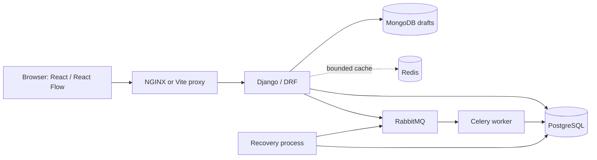
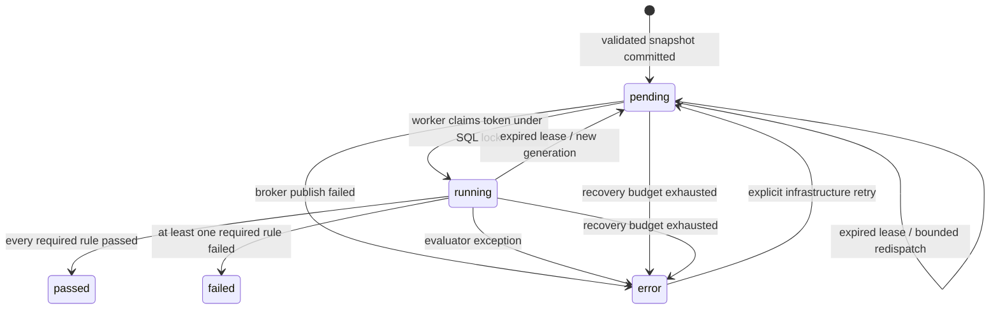

# Architecture and invariants

## Validation and models

`core/catalog.py` owns semantic type / technology pairs, effective defaults, configuration bounds and operation-specific compatibility. Graph validation makes a deep copy, rejects extra fields and invalid types, normalizes defaults, checks identifiers, sizes, endpoint existence, duplicates, self-loops, allowed directions and cycles. Python booleans are explicitly not accepted as integer instance counts. The client performs a convenient subset; Django is authoritative.

`core/evaluator.py` has no Django or network dependency. Each stable rule function takes the normalized graph and frozen lesson definition. Request reachability is rooted at exactly one client/application; connected resources downstream are checked with exact operations. Multiple eligible databases can satisfy URL-shortener/notification storage; the product-catalog topology explicitly restricts the total database count to one. Unrelated resources cannot add capacity. More than one passing design is supported.

Rule results include ID/title, required flag, boolean outcome, expected condition, concrete observed calculation, explanation, practical hint and related node/edge IDs. Score uses half-up integer rounding of `100 × passed required / total required`. Overall pass requires every required rule to pass regardless of rounding. Decimal arithmetic keeps cache load comparisons reproducible. Empty graphs are structurally valid but fail lesson requirements.

ChallengeVersion persists the complete prompt, constraints, assumptions, parameters, stable rule IDs and model/catalog versions in PostgreSQL. Seed refuses to change an existing version. PostgreSQL triggers also reject version updates and changes to submitted graphs, lesson references, evaluator versions and creation times. Ordinary model saves enforce the same immutability in isolated tests.

## Submission state machine

Dispatch occurs in `transaction.on_commit`. If publication fails, only the matching pending generation can become a broker error, so an ambiguous publish acknowledgment cannot overwrite a worker that already claimed or finished. If the API process dies after commit but before publishing, SQL remains pending and the recovery process redispatches after lease expiry.

Workers claim with `SELECT FOR UPDATE` and change pending to running. Evaluation runs outside the transaction; final writes compare both generation and running state. Duplicate deliveries are no-ops. Recovery changes the generation before redispatch so old workers cannot overwrite results. Celery uses late acknowledgment, worker-lost rejection, prefetch 1 and hard/soft time limits. A killed worker's immediate redelivery may see running and do nothing; the SQL recovery process resolves the expired lease. There is no assumption of exactly-once transport.

The recovery process is independent of RabbitMQ/Celery scheduling. Every 15 seconds it processes at most 100 stale rows (120-second lease). Three automatic recovery attempts are allowed. Explicit infrastructure retry resets the recovery budget but preserves snapshot and version. Evaluator exceptions are distinct from infrastructure errors and learner failure.

## Draft concurrency

Mongo's unique `_id` is the challenge slug in local demo mode. Revision 0 inserts; concurrent inserts produce a 409. Subsequent saves atomically replace only a matching `_id` + revision and increment revision. Layout, viewport and configuration travel together. Submission never reads this document, so a draft write failure cannot corrupt a submitted snapshot. No cross-database transaction exists.

The frontend saves the edit counter at request time and clears the dirty indicator only if no later edits happened while the save was in flight. It updates revision even when further edits exist. Conflict reload asks before replacing unsaved work. Current results are keyed by submission ID rather than current graph state.

## Cache and network

Redis keys contain catalog version and, for the challenge list, current version IDs. Entries expire after 60 seconds; reseed invalidates the Failover namespace. Redis has a 32 MB allkeys-lru bound. Cache failures fall back to authoritative reads, and completion status is overlaid directly from PostgreSQL to prevent stale progress badges.

Frontend assets and API share an origin. SPA deep links use NGINX `try_files` fallback; `/api/` is proxied to Django. Vite provides the same API prefix during development. Database/broker ports stay private to Compose. The only default published port is `127.0.0.1:8080`.

## Dependency API references

Implementation checked against [React Flow node/state APIs](https://reactflow.dev/api-reference/hooks/use-nodes-state), [React Flow instance methods](https://reactflow.dev/api-reference/types/react-flow-instance), [Vite's runtime requirements](https://vite.dev/guide/), [Django 5.2 Python compatibility](https://docs.djangoproject.com/en/5.2/releases/5.2/), and [Celery task acknowledgment/time-limit guidance](https://docs.celeryq.dev/en/stable/userguide/tasks.html). Resolved exact versions live in the lockfiles. React Flow's helper `addEdge` collapses same-endpoint connections, so the editor constructs operation-specific edges directly and validates exact `(source, target, operation)` duplicates itself.
